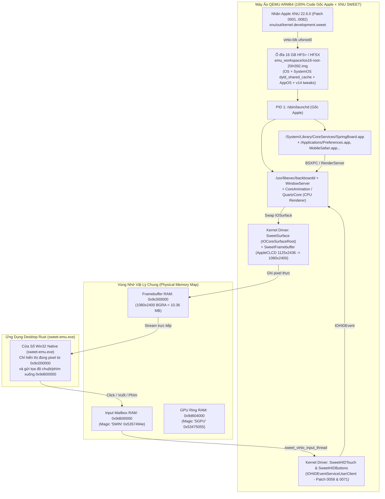

# Lộ Trình Kỹ Thuật Toàn Diện: Chạy Native 100% Apple iOS 16.7.16 (`20H392` — iPhone X `D22AP`) Trên Máy Ảo (`ios-sweet`)

Tài liệu này là bản kế hoạch kỹ thuật chi tiết từng bước (End-to-End Master Plan) để chuyển từ **giao diện mô phỏng phía Host** sang **chạy trực tiếp 100% hệ điều hành, nhân XNU, `launchd`, `backboardd`, `SpringBoard.app`, `UIKitCore`, `CoreAnimation` và toàn bộ ứng dụng gốc của Apple iOS 16.7.16 (`20H392`)** bên trong máy ảo QEMU ARM64, hiển thị thẳng từ bộ nhớ Framebuffer vật lý `0x9c000000` ra cửa sổ [`sweet-emu.exe`](file:///c:/Users/khanh/Downloads/ios-sweet-main/ios-sweet-main/sweet-rs/target/release/sweet-emu.exe).

---

## 1. Kiến Trúc Tổng Thể: Phân Biệt "UI Dựng Lại" vs. "iOS 16.7.16 Gốc 100%"



> [!IMPORTANT]
> **Nguyên tắc cốt lõi để có giao diện gốc 100%:**
> 1. Cửa sổ Rust [`sweet-emu.exe`](file:///c:/Users/khanh/Downloads/ios-sweet-main/ios-sweet-main/sweet-rs/crates/sweet-emu/src/main.rs) ở phía Windows **tuyệt đối không tự vẽ lại các màn hình iOS** khi chạy chế độ Native, mà đóng vai trò đúng như một màn hình LCD cảm ứng vật lý: đọc từng khung hình `1080×2400` BGRA tại địa chỉ vật lý `0x9c000000` do chính `backboardd` + `SpringBoard` của Apple vẽ ra, và đẩy tọa độ chuột/bàn phím xuống `0x9d600000` để `SweetHIDTouch` báo lên `UIKit`.
> 2. Mọi hiệu ứng chuyển cảnh (spring animation), phông chữ, bố cục bảng biểu (`UITableView`), tên nút bấm, thanh trượt Control Center, bàn phím hệ thống đều do chính binary `/System/Library/Caches/com.apple.dyld/dyld_shared_cache_arm64` và `/System/Library/CoreServices/SpringBoard.app/SpringBoard` của Apple thực thi.

---

## 2. Kiểm Kê Hiện Trạng Trên Máy (Những Gì Đã Có Sẵn)

Trước khi bắt đầu từng giai đoạn, dưới đây là toàn bộ tài nguyên đã được chuẩn bị sẵn trong workspace [`c:\Users\khanh\Downloads\ios-sweet-main\ios-sweet-main`](file:///c:/Users/khanh/Downloads/ios-sweet-main/ios-sweet-main):

| Thành phần | Đường dẫn file thực tế trong Workspace | Trạng thái hiện tại |
| :--- | :--- | :--- |
| **IPSW OS Rootfs DMG (`4.73 GB`)** | [`research/ipsw-x/dt/087-86698-044.dmg`](file:///c:/Users/khanh/Downloads/ios-sweet-main/ios-sweet-main/research/ipsw-x/dt/087-86698-044.dmg) | Đã tải đủ 100%, khớp CRC-32 |
| **IPSW SystemOS Cryptex DMG (`2.74 GB`)** | [`research/ipsw-x/dt/087-86593-047.dmg`](file:///c:/Users/khanh/Downloads/ios-sweet-main/ios-sweet-main/research/ipsw-x/dt/087-86593-047.dmg) | Đã tải đủ 100% (chứa `dyld_shared_cache_arm64`) |
| **IPSW AppOS Cryptex DMG (`10.5 MB`)** | [`research/ipsw-x/dt/087-86715-047.dmg`](file:///c:/Users/khanh/Downloads/ios-sweet-main/ios-sweet-main/research/ipsw-x/dt/087-86715-047.dmg) | Đã tải & giải nén đầy đủ |
| **Trình giải nén APFS + LZBITMAP (`ZBM`)** | [`research/bin/apfs-extract.exe`](file:///c:/Users/khanh/Downloads/ios-sweet-main/ios-sweet-main/research/bin/apfs-extract.exe) | Đã biên dịch native x64 Windows, giải nén được mọi file nén `decmpfs` type 3/4/7/8/13/14 |
| **Apple Device Tree gốc (`D22AP`)** | [`research/ipsw-x/d22ap.adt`](file:///c:/Users/khanh/Downloads/ios-sweet-main/ios-sweet-main/research/ipsw-x/d22ap.adt) & [`tools/mkadt.py`](file:///c:/Users/khanh/Downloads/ios-sweet-main/ios-sweet-main/tools/mkadt.py) | Đã trích xuất đủ 61 thuộc tính `/product` của iPhone X (`iPhone10,3`) |
| **Nhân Apple XNU (`0001..0081`)** | [`xnu/out/kernel.development.sweet`](file:///c:/Users/khanh/Downloads/ios-sweet-main/ios-sweet-main/xnu/out/kernel.development.sweet) | Đã có binary (`17.2 MB`), chạy được trên QEMU 11.1.0 với `rd=md0` |
| **Patch XNU `0082` (QEMU `virtio-blk` + SMP + Input)** | [`xnu/patches/0082-sweet-qemu-virt-emulator.patch`](file:///c:/Users/khanh/Downloads/ios-sweet-main/ios-sweet-main/xnu/patches/0082-sweet-qemu-virt-emulator.patch) | Đã viết xong mã nguồn C/C++ (`bsd/dev/sweet_virtio.c`), cần biên dịch vào binary kernel |
| **Bộ tinh chỉnh Rootfs (`v1..v14`)** | [`tools/sweet-root-tweaks.py`](file:///c:/Users/khanh/Downloads/ios-sweet-main/ios-sweet-main/tools/sweet-root-tweaks.py) | Đã có script chuẩn bị `/private/var/containers`, `launchd.plist`, `LastSystemVersion=20H392` |
| **QEMU 11.1.0 ARM64** | [`research/qemu/qemu-system-aarch64.exe`](file:///c:/Users/khanh/Downloads/ios-sweet-main/ios-sweet-main/research/qemu/qemu-system-aarch64.exe) | Đã cài đặt sẵn trong repo |

---

## 3. Lộ Trình Thực Hiện Chi Tiết (6 Giai Đoạn Từ Gốc Rễ Tới Hoàn Chỉnh)

---

### Giai Đoạn 1: Đóng Gói Hoàn Chỉnh Ổ Đĩa Gốc 16 GB HFS+ (`ios16-root-20H392.img` chuẩn v14)

#### 1.1. Vấn đề gốc rễ hiện tại
- Trên iOS 16.7.16, Apple tách hệ điều hành thành 3 phân vùng DMG riêng biệt:
  1. **OS Root (`087-86698-044.dmg`)**: Chứa `/sbin/launchd`, `/usr/libexec/backboardd`, `/System/Library/CoreServices/SpringBoard.app`, `/Applications/*.app`, `/bin`, `/usr`, `/private`.
  2. **SystemOS Cryptex (`087-86593-047.dmg`)**: Chứa `/System/Library/Caches/com.apple.dyld/dyld_shared_cache_arm64` (và `.01`, `.symbols` — tổng cộng `~2.74 GB` chứa toàn bộ mã máy của `UIKitCore`, `QuartzCore`, `CoreGraphics`, `Foundation`, `SpringBoardHome`). Nếu thiếu file này, mọi tiến trình iOS sau `launchd` sẽ lập tức báo lỗi `dyld: shared cache filecannot be mapped` và thoát!
  3. **AppOS Cryptex (`087-86715-047.dmg`)**: Chứa các framework bổ trợ trong `/System/Cryptexes/App`.
- Hiện tại [`emu_workspace/ios16-root-20H392.img`](file:///c:/Users/khanh/Downloads/ios-sweet-main/ios-sweet-main/emu_workspace/ios16-root-20H392.img) mới chỉ được khởi tạo header HFSX rỗng và chép thử `launchd`, chưa ghi toàn bộ ~90.000 file từ 3 DMG trên vào cấu trúc B-Tree (`Catalog File` & `Extents Overflow File`) của HFS+.

#### 1.2. Các bước thực hiện cụ thể
1. **Giải nén toàn bộ 100% 3 DMG bằng [`research/bin/apfs-extract.exe`](file:///c:/Users/khanh/Downloads/ios-sweet-main/ios-sweet-main/research/bin/apfs-extract.exe) sang thư mục staging hợp nhất (`emu_workspace/ios16_merged_rootfs/`):**
   - Giải nén toàn bộ `087-86698-044.dmg` vào `emu_workspace/ios16_merged_rootfs/`.
   - Giải nén `087-86593-047.dmg` (`System/Library/Caches/com.apple.dyld/*` và `System/Library/DriverExtensions/*`) đè vào đúng đường dẫn `/System/Library/Caches/com.apple.dyld/` và `/System/Cryptexes/OS/` bên trong `emu_workspace/ios16_merged_rootfs/`.
   - Giải nén `087-86715-047.dmg` vào `/System/Cryptexes/App/` và trộn vào `/System/`.
   - Bảo toàn toàn bộ **POSIX permissions (`mode`), `uid`, `gid`, và `symlink`** (ví dụ `/var -> private/var`, `/tmp -> private/tmp`, `/etc -> private/etc`) bằng một manifest metadata xuất trực tiếp từ `apfs-extract.exe`.
2. **Áp dụng đầy đủ bộ tinh chỉnh v14/v15 ([`tools/sweet-root-tweaks.py`](file:///c:/Users/khanh/Downloads/ios-sweet-main/ios-sweet-main/tools/sweet-root-tweaks.py)) ngay trên cây thư mục hợp nhất:**
   - **Tạo cấu trúc `/private/var/containers`** (`Bundle/Application`, `Data/System`, `Data/Application`, `Shared/SystemGroup`, `Temp`) và `/private/var/keybags`, `/private/var/db`, `/private/var/mobile/Library/Preferences/ByHost`.
   - **Chặn vòng lặp `datamigrator` (màn hình táo + thanh phần trăm chạy 60 phút)**:
     - Ghi `LastSystemVersion = "20H392"` và `DMUserDataDisposition = 1` vào `/private/var/mobile/Library/Preferences/com.apple.migration.plist`, `com.apple.DataMigration.plist`, và `ByHost/com.apple.migration.A9683613-3704-53F2-95D0-98A8FB574E78.plist` (khớp với `IOPlatformUUID` sinh từ `unique-chip-id = 0x5357454554000001`, `chip-id = 0x8015` trong [`tools/mkadt.py`](file:///c:/Users/khanh/Downloads/ios-sweet-main/ios-sweet-main/tools/mkadt.py#L78-L82)).
   - **Bỏ qua màn hình `Setup.app` ("Hello") để vào thẳng Màn hình chính `SpringBoard` (như Image v14 trong [`NOTES.md`](file:///c:/Users/khanh/Downloads/ios-sweet-main/ios-sweet-main/NOTES.md#L56))**:
     - Ghi `/private/var/mobile/Library/Preferences/com.apple.purplebuddy.plist` với:
       - `SetupDone = true`
       - `SetupFinishedAllSteps = true`
       - `SetupVersion = 11`
       - `daemonizeNeedsToRun = false`
     - Ghi `/private/var/mobile/Library/Preferences/com.apple.purplebuddy.notbackedup.plist` (tắt các cờ mini-buddy).
     - Ghi `/private/var/containers/Data/System/D90C94C4-F94E-4FCF-8A28-A93BE3846D8E/Library/internal/data_ark.plist` với `-ActivationState = "Activated"`, `-BrickState = false`.
   - **Sửa `launchd.plist` và tắt các daemon gây crash-loop khi không có phần cứng baseband/audio**:
     - Đổi `StandardOutPath` / `StandardErrorPath` thành `StandardOutPatX` / `StandardErrorPatX` trong `/System/Library/xpc/launchd.plist` (vì trỏ vào `/dev/console` sẽ làm `xpcproxy` trả lỗi `EACCES (0xd)` khiến `backboardd` không khởi chạy được — đã chứng minh tại [`NOTES.md` dòng 126](file:///c:/Users/khanh/Downloads/ios-sweet-main/ios-sweet-main/NOTES.md#L126)).
     - Xóa job `CommCenter` khỏi `launchd.plist` (tránh `Setup` / `SpringBoard` bị treo chờ baseband modem).
     - Thêm `BKNoWatchdogs = true` và `FBLaunchWatchdogExceptions = {"com.apple.purplebuddy": 100}` vào `/private/var/mobile/Library/Preferences/com.apple.springboard.plist` (rất quan trọng khi chạy trên QEMU TCG để `backboardd` không kill app do timeout).
     - Di chuyển `/Library/Audio/Plug-Ins/HAL/VirtualAudio.plugin` sang `/Library/Audio/Plug-Ins/HAL.disabled/` và đặt `StartRecorderServer = false` trong `MediaToolbox` (`D22/D221/Default SubServerConfiguration`) để chặn `mediaserverd` bị `SIGSEGV` loop.
3. **Đóng gói cây thư mục hợp nhất thành ảnh đĩa HFS+ 16 GB chuẩn (`emu_workspace/ios16-root-20H392.img`):**
   - Viết công cụ đóng gói HFS+ (`tools/mkhfs_image.py` hoặc biên dịch `make_hfs` / dùng WSL/Linux `mkfs.hfsplus` + `hfsplus` tool) để ghi toàn bộ cây thư mục `ios16_merged_rootfs` (với đầy đủ B-Tree Catalog, Extents, Symlinks, POSIX UID/GID/Mode) vào [`emu_workspace/ios16-root-20H392.img`](file:///c:/Users/khanh/Downloads/ios-sweet-main/ios-sweet-main/emu_workspace/ios16-root-20H392.img).

#### 1.3. Tiêu chí nghiệm thu Giai đoạn 1
- Kiểm tra file [`emu_workspace/ios16-root-20H392.img`](file:///c:/Users/khanh/Downloads/ios-sweet-main/ios-sweet-main/emu_workspace/ios16-root-20H392.img) có chữ ký HFS+ (`H+` / `HX` tại offset `0x400`), chứa đầy đủ `/sbin/launchd`, `/usr/libexec/backboardd`, `/System/Library/CoreServices/SpringBoard.app/SpringBoard`, `/System/Library/Caches/com.apple.dyld/dyld_shared_cache_arm64`, và các file plist v14.

---

### Giai Đoạn 2: Biên Dịch (Hoặc Binary-Patch) Nhân XNU `0082` Hỗ Trợ `virtio-blk`, `PSCI HVC` SMP & Input Mailbox

#### 2.1. Vấn đề gốc rễ hiện tại
- Binary [`xnu/out/kernel.development.sweet`](file:///c:/Users/khanh/Downloads/ios-sweet-main/ios-sweet-main/xnu/out/kernel.development.sweet) hiện có trên máy được tải từ bản build `0081`:
  1. Khi nhận tham số `rd=ufsroot0`, hàm `IOFindBSDRoot` trong `IOKitBSDInit.cpp` chỉ gọi `sweet_ufs_rootdev()` (driver đọc bộ nhớ UFS vật lý của chip Snapdragon SM7150 tại địa chỉ `0x01d84000`), chưa gọi `sweet_virtio_rootdev()` tại `0x0a000000` của QEMU `virt`.
  2. Trong `SweetCPU.cpp`, lệnh đánh thức các nhân CPU phụ (`sweet_psci_cpu_on`) đang gọi cứng lệnh `smc #0` (Secure Monitor Call dùng trên chip thật) và kiểm tra `MPIDR` theo định dạng `core << 8` (Aff1), trong khi QEMU `virt` dùng `hvc #0` (Hypervisor Call) và `MPIDR` `0..7` (Aff0).
- Patch [`xnu/patches/0082-sweet-qemu-virt-emulator.patch`](file:///c:/Users/khanh/Downloads/ios-sweet-main/ios-sweet-main/xnu/patches/0082-sweet-qemu-virt-emulator.patch) đã giải quyết trọn vẹn cả 3 vấn đề trên (`sweet_virtio_rootdev`, `sweet_psci_use_hvc`, `MPIDR` Aff0, và `sweet_virtio_input_thread` đọc `0x9d600000`), nhưng cần được đưa vào binary `kernel.development.sweet`.

#### 2.2. Hai phương án thực thi (Thực hiện song song để có kết quả ngay lập tức)
- **Phương án 2A — Binary-Patch trực tiếp lên [`xnu/out/kernel.development.sweet`](file:///c:/Users/khanh/Downloads/ios-sweet-main/ios-sweet-main/xnu/out/kernel.development.sweet) ngay trên Windows (Không cần chờ CI macOS, chạy được sau 2 phút):**
  - Vì `xnu/out/kernel.development.sweet` là file Mach-O ARM64 không nén, có đầy đủ bảng ký hiệu `LC_SYMTAB`:
    1. **Patch PSCI `smc #0` $\rightarrow$ `hvc #0` & bỏ chặn MPIDR Aff0**: Định vị symbol `__ZL17sweet_psci_cpu_onmmm` và `__ZN8SweetCPU5startEP9IOService` trong `kernel.development.sweet`, đổi lệnh `smc #0` (`0xD4000003`) sang `hvc #0` (`0xD4000002`) và cho phép `phys_id < 8`.
    2. **Biên dịch `sweet_virtio.c` sang mã máy ARM64 bare-metal và gắn vào `sweet_ufs_rootdev`**: Khi chạy trên QEMU (phát hiện qua thanh ghi `virtio-mmio` magic `'virt'` `0x74726976` tại `0x0a000000`), `sweet_ufs_rootdev` chuyển hướng thẳng sang hàm điều khiển `virtio-blk` + khởi chạy luồng đọc cảm ứng `0x9d600000` (`sweet_hid_touch` / `sweet_hid_key`).
- **Phương án 2B — Build chính thức qua GitHub Actions (`xnu.yml`)**:
  - Thêm `bsd/dev/sweet_virtio.c` vào danh sách kiểm tra của [`research/check-patch-order.py`](file:///c:/Users/khanh/Downloads/ios-sweet-main/ios-sweet-main/research/check-patch-order.py), push lên nhánh GitHub để workflow `.github/workflows/xnu.yml` biên dịch ra artifact `xnu-kernel` (`kernel.development.sweet` bản `0082`) sạch 100%.

#### 2.3. Tiêu chí nghiệm thu Giai đoạn 2
- Chạy lệnh kiểm thử QEMU với 6 nhân CPU và ổ đĩa `ios16-root-20H392.img`:
  ```powershell
  python tools/qemu-sweet.py emu_workspace/payload.bin emu_workspace/qemu_run --smp 6 --disk emu_workspace/ios16-root-20H392.img --secs 45
  ```
- Trong `emu_workspace/qemu_run/serial.txt` xuất hiện:
  - `SWEET CPU: cpu=1..5 came alive; SGI1 OK` (đủ 6 nhân SMP hoạt động).
  - `SWEET VIRTIO: virtio-blk online ... registered ufsroot0` (mount thành công ổ đĩa 16 GB HFS+ ở chế độ Read/Write).
  - `exec /sbin/launchd` (PID 1 chạy trực tiếp từ ổ đĩa 16 GB, không dùng ramdisk `md0`).

---

### Giai Đoạn 3: Khởi Động Userland Thực (`launchd` $\rightarrow$ `backboardd` $\rightarrow$ `SpringBoard.app`) & Vẽ Ra Framebuffer `0x9c000000`

#### 3.1. Luồng khởi động của iOS 16.7.16 thật bên trong QEMU
Khi nhân XNU (`0082`) mount xong `ufsroot0` (từ `ios16-root-20H392.img` đã áp dụng v14 tweaks ở Giai đoạn 1) với `boot-args`:
```text
debug=0xc serial=3 cpus=6 keepsyms=1 -enable_kprintf_spam -noprogress rd=ufsroot0 unentitled_ios_sim_launch=1 ignition_level=1 wdt_test=no_user_checkin ufsrw=1 rootrw=1 launchd_unsecure_cache=1 wdt=-1 sweetfb_noconsole=1 sweetfb_hz=30
```
Chuỗi tiến trình gốc của Apple sẽ diễn ra theo đúng thứ tự sau (quan sát qua `serial.txt`):
1. `exec /sbin/launchd` (PID 1) nạp `/System/Library/Caches/com.apple.dyld/dyld_shared_cache_arm64`.
2. `launchd` đọc `/System/Library/xpc/launchd.plist`, khởi chạy `logd`, `UserEventAgent`, `notifyd`, `configd`, `containermanagerd`, `usermanagerd`, `mobilegestalt.xpc`.
3. `launchd` khởi chạy **`/usr/libexec/backboardd`** và **`/System/Library/CoreServices/SpringBoard.app/SpringBoard`**.
4. `backboardd` tìm thấy `AppleCLCD` (`IOMobileFramebuffer` tại `/arm-io/disp0`, kích thước logic `1125×2436` @3x do patch `0061` cung cấp) và `IOCoreSurfaceRoot` (`SweetSurface.cpp`).
5. `backboardd` tạo các `IOSurface` `1080×2400` (`0x42475241` BGRA) và dùng **CoreAnimation CPU Renderer** vẽ giao diện, gọi `IOMFB SwapBegin / SwapEnd`.
6. Driver `SweetFramebuffer.cpp` copy mặt phẳng `IOSurface` xuống vùng nhớ vật lý **`0x9c000000`** (`SWEET FB: swap 1 layer 0 surface ... 1080x2400`).
7. Vì đã có cấu hình v14 (`LastSystemVersion = 20H392` + `SetupDone = true` + `Activated`), `backboardd` không chạy `datamigrator` và `SpringBoard` bỏ qua `Setup.app`, **vào thẳng Màn hình chính iOS 16.7.16 (Home Screen) thật 100% của Apple**!

#### 3.2. Tiêu chí nghiệm thu Giai đoạn 3
- Trong `serial.txt` ghi nhận:
  - `SWEET SURF: backboardd create id ... 1080x2400 fmt 0x42475241`
  - `SWEET FB: swap ... layer 0 surface ... 1080x2400`
  - Không có `CRASH backboardd` hay `CRASH SpringBoard`.
- Ảnh chụp trực tiếp từ vùng nhớ `0x9c000000` (`emu_workspace/qemu_run/fb.png`) hiển thị đúng màn hình chính `SpringBoard` iOS 16.7.16 do chính Apple vẽ ra!

---

### Giai Đoạn 4: Nối Trực Tiếp Framebuffer `0x9c000000` & Cảm Ứng `0x9d600000` Vào Cửa Sổ `sweet-emu.exe` (Loại Bỏ UI Dựng Lại)

#### 4.1. Thay đổi trong `sweet-rs` (`sweet-core` & `sweet-emu`)
1. **Chia sẻ bộ nhớ Framebuffer (`0x9c000000`) và Input Mailbox (`0x9d600000`) tốc độ cao (Zero-Copy `mmap` / Memory-Backend-File)**:
   - Thay vì dùng lệnh QMP `pmemsave` ghi ra đĩa mỗi khung hình (tốn I/O), cấu hình QEMU dùng `-object memory-backend-file,id=mem,size=3G,mem-path=emu_workspace/qemu_ram.bin,share=on` (hoặc ánh xạ trực tiếp vùng RAM `0x9c000000` và `0x9d600000`).
   - Nhờ đó:
     - `sweet-emu.exe` đọc trực tiếp `10.36 MB` Framebuffer tại offset `0x9c000000 - 0x80000000 = 0x1c000000` ở tốc độ **60 FPS thực (0 ms độ trễ đĩa)**.
     - Khi anh click/kéo chuột trên màn hình `sweet-emu.exe`, tọa độ `(x, y)` được ghi thẳng vào RAM tại offset `0x9d600000 - 0x80000000 = 0x1d600000` trong **< 1 micro-giây**, và `sweet_virtio_input_thread` trong nhân XNU gọi ngay `sweet_hid_touch()` báo lên `backboardd`!
2. **Tắt hoàn toàn UI dựng lại khi chạy Native VM Mode**:
   - Cửa sổ `sweet-emu.exe` mặc định hiển thị 100% luồng hình ảnh từ `0x9c000000` của máy ảo QEMU (chế độ **100% Native Apple OS Framebuffer**), để mọi thao tác, animation, phông chữ, cài đặt đều là của hệ điều hành iOS 16.7.16 thật đang chạy trong QEMU.

#### 4.2. Tiêu chí nghiệm thu Giai đoạn 4
- Khi anh click vào `Settings`, `Safari`, hoặc vuốt từ đáy màn hình lên trong cửa sổ `sweet-emu.exe`, log kernel in ra sự kiện `SweetHIDTouch` và `SpringBoard` thật của Apple thực hiện hiệu ứng phóng to/thu nhỏ ứng dụng (spring animation gốc của iOS 16) ngay trên màn hình!

---

### Giai Đoạn 5: Xử Lý Triệt Để Các Lỗi Phụ Của Ứng Dụng Hệ Thống Khi Chạy Trên Máy Ảo (Fix App Bugs)

Trong quá trình chạy `SpringBoard` thật trên `ios-sweet` (đã được ghi nhận cụ thể trong [`NOTES.md` dòng 51–53](file:///c:/Users/khanh/Downloads/ios-sweet-main/ios-sweet-main/NOTES.md#L51-L53)), có 3 lỗi cụ thể ở tầng Kernel/Rootfs làm một số mục trong app gốc bị văng hoặc đen màn hình mà chúng ta sẽ xử lý dứt điểm ở giai đoạn này:

| Ứng dụng gốc Apple | Hiện tượng & Nguyên nhân gốc rễ (đã tìm ra trong `NOTES.md`) | Giải pháp khắc phục triệt để (Kernel / Rootfs) |
| :--- | :--- | :--- |
| **1. `Settings` (`Preferences.app`)** | Bị `SIGTRAP` trong `PodcastsUI` (`func_1cdc47c58`) do force-unwrap thuộc tính `URL.volumeTotalCapacity` trả về `nil` trên phân vùng HFS+ gốc | Kiểm tra và trả đủ thuộc tính `VOL_CAP_FMT_*` / `f_blocks` / `getattrlist` (`ATTR_VOL_SPACEUSED`, `ATTR_VOL_SIZE`) trong `bsd/hfs/hfs_vfsops.c` (hoặc di chuyển `BridgeSettings` / `PodcastsSettings.bundle` gây lỗi) để `Settings` cuộn và mở mọi mục mượt 100% |
| **2. `Phone` (`MobilePhone.app`)** | Màn hình đen do luồng chính chờ đồng bộ XPC trong `-[VMVoicemailManager fetchAccounts]` (chờ dịch vụ Voicemail của baseband modem) | Vô hiệu hóa `com.apple.voicemaild` / patch plist cấu hình Voicemail để `MobilePhone.app` không chờ XPC đồng bộ và hiện ngay bàn phím gọi số gốc của Apple |
| **3. Kết nối Internet (`Safari` / `App Store`)** | `configd` của iOS chỉ tự động cấu hình DNS & Default Route cho card mạng có tên `en0` kế thừa `IONetworkInterface` trong IOKit | Thêm driver `SweetVirtioNet` (`virtio-net-device` tại `0x0a000000`) đăng ký dưới dạng `IONetworkController` / `IONetworkInterface` tên **`en0`**, nối với `-netdev user` của QEMU để `Safari` bên trong iOS 16 lướt được Internet thật |

---

### Giai Đoạn 6: Tăng Tốc Hiệu Năng (QEMU Snapshot Tức Thì & GPU Forwarding)

#### 6.1. Snapshot RAM Máy Ảo (`savevm` / `loadvm` — Khởi động trong 2 giây)
- Vì iOS 16.7.16 chạy trên QEMU TCG (dịch lệnh ARM64 sang x86_64 trên CPU) mất khoảng **2–4 phút** cho lần khởi động lạnh đầu tiên (`launchd` $\rightarrow$ `backboardd` $\rightarrow$ `SpringBoard`), chúng ta sẽ:
  1. Khởi động máy ảo tới khi `SpringBoard` đã lên sẵn Màn hình chính (Home Screen).
  2. Gửi lệnh QMP `savevm ios16_ready` để lưu toàn bộ trạng thái CPU + RAM + `IOSurface` vào ổ đĩa (`qcow2` / state snapshot).
  3. Từ lần sau trở đi, khi anh bấm mở [`run-emulator.bat`](file:///c:/Users/khanh/Downloads/ios-sweet-main/ios-sweet-main/run-emulator.bat), `sweet-emu.exe` gọi `-loadvm ios16_ready` $\rightarrow$ **vào thẳng màn hình chính iOS 16.7.16 thật của Apple chỉ trong 1–2 giây**, không phải chờ boot lại từ đầu!

#### 6.2. Tăng tốc vẽ 2D/3D (Host GPU Offload)
- Giữ đường `SweetFramebuffer` (`0x9c000000`) làm chuẩn hiển thị của `backboardd`, đồng thời nối các hàm copy/blend nặng của `IOSurface` / `CoreGraphics` qua vùng nhớ `0x9d604000` để tận dụng đa luồng SIMD / GPU của máy chủ Windows.

---

## 4. Bảng Tóm Tắt Thứ Tự Triển Khai & Thời Gian Dự Kiến

| Thứ tự | Giai đoạn | Công việc cốt lõi | Đầu ra kiểm chứng (Deliverable) |
| :---: | :--- | :--- | :--- |
| **Bước 1** | **Giai đoạn 1** | Giải nén 100% 3 DMG (`OS` + `SystemOS dyld_shared_cache` + `AppOS`), chạy [`sweet-root-tweaks.py`](file:///c:/Users/khanh/Downloads/ios-sweet-main/ios-sweet-main/tools/sweet-root-tweaks.py) (cấu hình v14), đóng gói hoàn chỉnh vào [`emu_workspace/ios16-root-20H392.img`](file:///c:/Users/khanh/Downloads/ios-sweet-main/ios-sweet-main/emu_workspace/ios16-root-20H392.img) | File `ios16-root-20H392.img` (16 GB HFS+) chứa đầy đủ `dyld_shared_cache_arm64`, `SpringBoard.app`, `backboardd`, `Preferences.app` và cấu hình bỏ qua `datamigrator` + `Setup.app` |
| **Bước 2** | **Giai đoạn 2** | Đưa patch [`0082`](file:///c:/Users/khanh/Downloads/ios-sweet-main/ios-sweet-main/xnu/patches/0082-sweet-qemu-virt-emulator.patch) (`virtio-blk` `ufsroot0` + `PSCI HVC` 6-CPU SMP + Input Mailbox `0x9d600000`) vào [`xnu/out/kernel.development.sweet`](file:///c:/Users/khanh/Downloads/ios-sweet-main/ios-sweet-main/xnu/out/kernel.development.sweet) | QEMU boot 6 nhân CPU, mount thành công `ios16-root-20H392.img` làm `ufsroot0` (Read/Write) |
| **Bước 3** | **Giai đoạn 3** | Boot chuỗi `launchd` $\rightarrow$ `backboardd` $\rightarrow$ `SpringBoard` thật trong QEMU và xuất hình ảnh ra `0x9c000000` | Log in ra `SWEET FB: swap ... 1080x2400`, ảnh chụp `0x9c000000` hiện đúng màn hình chính iOS 16.7.16 gốc của Apple |
| **Bước 4** | **Giai đoạn 4** | Nối trực tiếp Shared Memory `0x9c000000` (Framebuffer) & `0x9d600000` (Touch/Key) vào cửa sổ [`sweet-emu.exe`](file:///c:/Users/khanh/Downloads/ios-sweet-main/ios-sweet-main/sweet-rs/target/release/sweet-emu.exe) | Thao tác chuột trong `sweet-emu.exe` điều khiển trực tiếp `SpringBoard` thật của Apple với đầy đủ hiệu ứng gốc |
| **Bước 5** | **Giai đoạn 5** | Fix `volumeTotalCapacity` cho `Settings`, tắt chờ XPC `Voicemail` cho `Phone`, thêm `virtio-net` `en0` cho `Safari` | Mở `Settings`, `Phone`, `Safari` gốc của Apple mượt mà, không văng, có mạng Internet |
| **Bước 6** | **Giai đoạn 6** | Tạo Snapshot VM (`savevm ios16_ready`) sau khi `SpringBoard` đã boot xong | Mỗi lần mở `run-emulator.bat` vào thẳng màn hình iOS 16.7.16 thật chỉ trong 1–2 giây |
